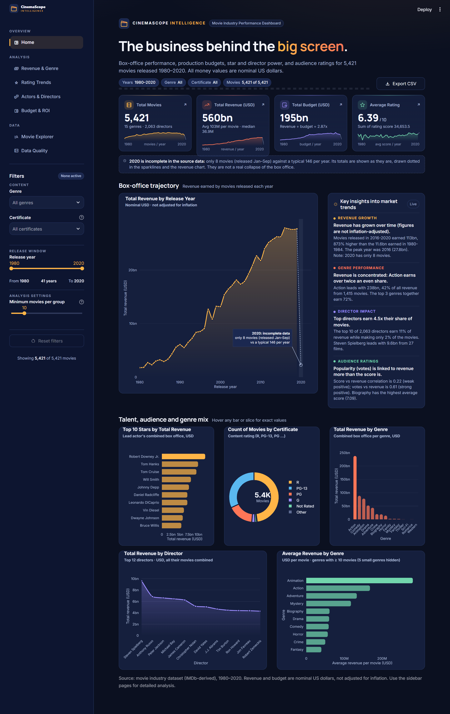
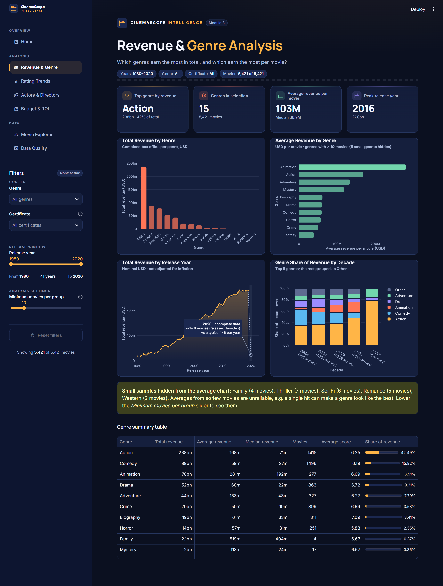
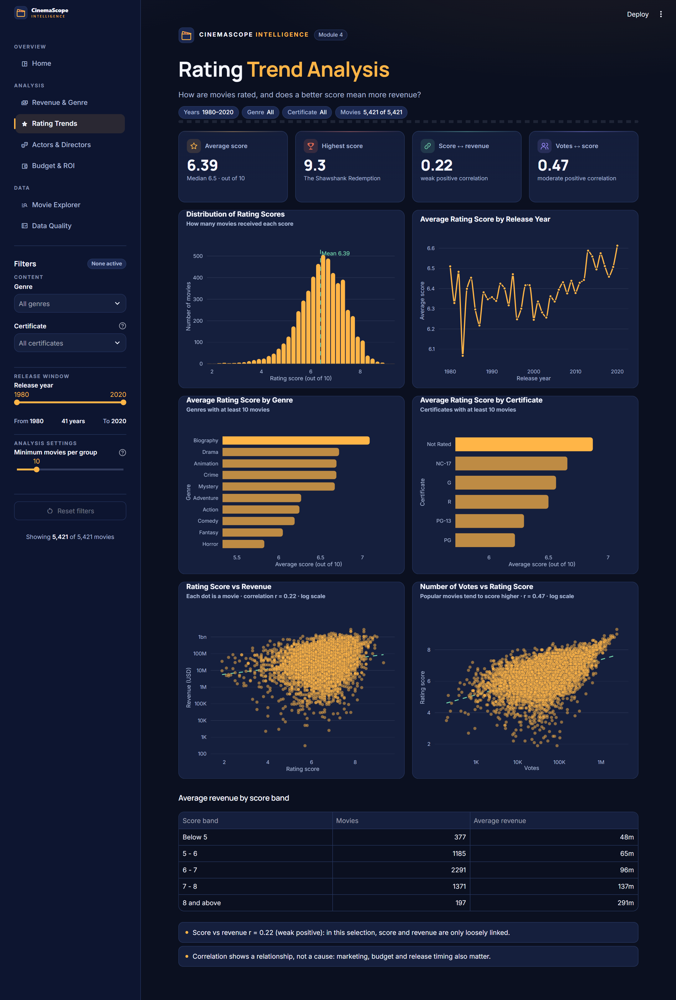
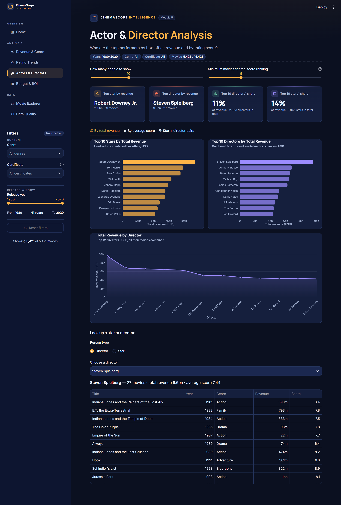
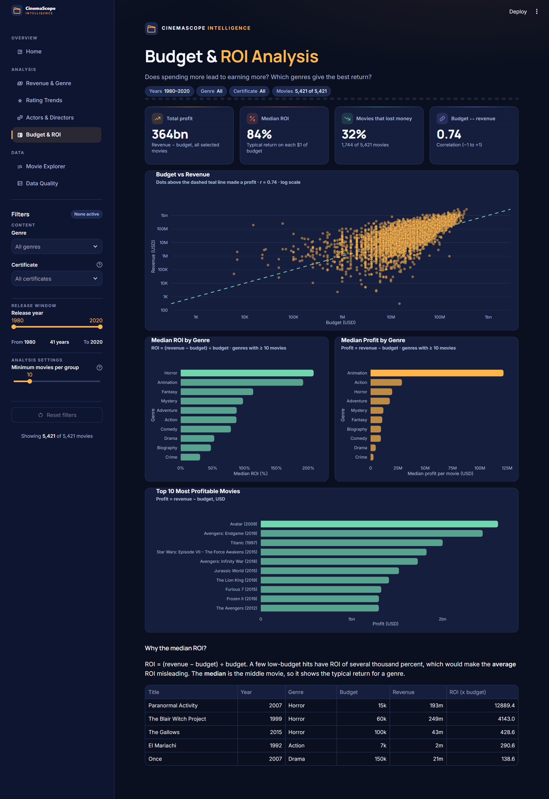
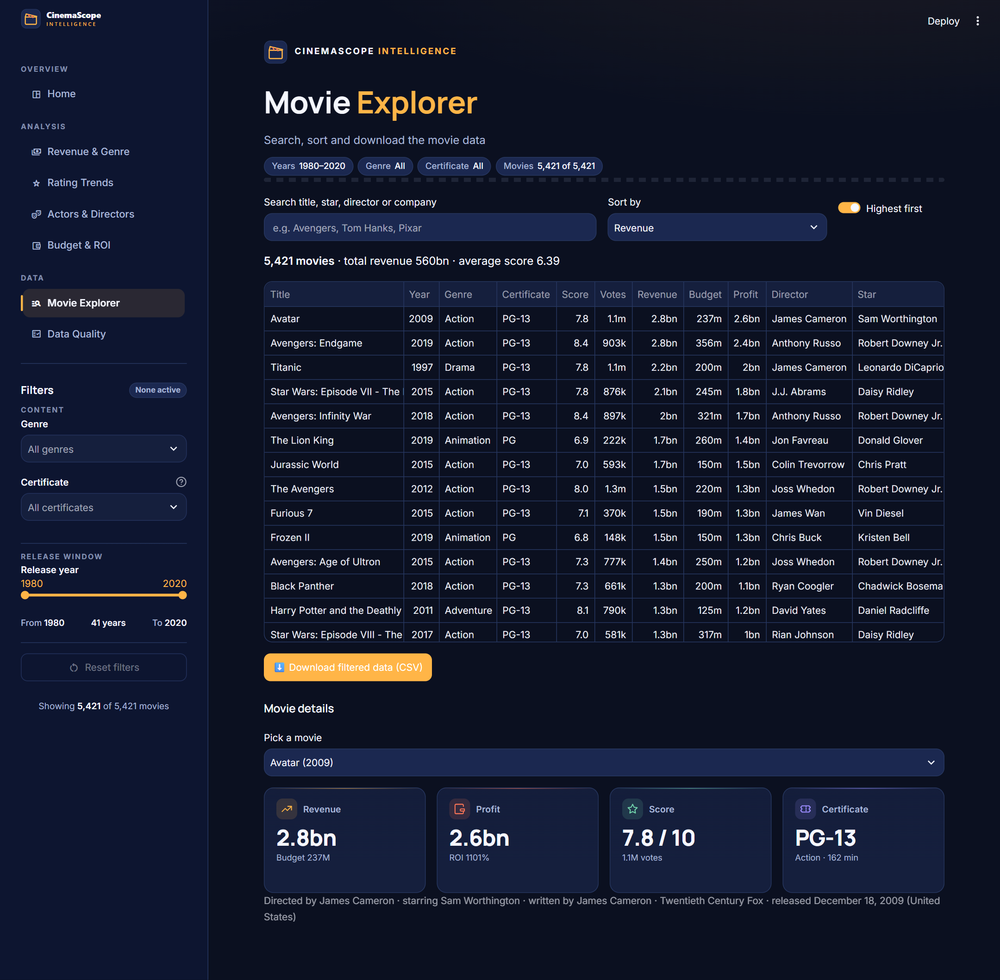
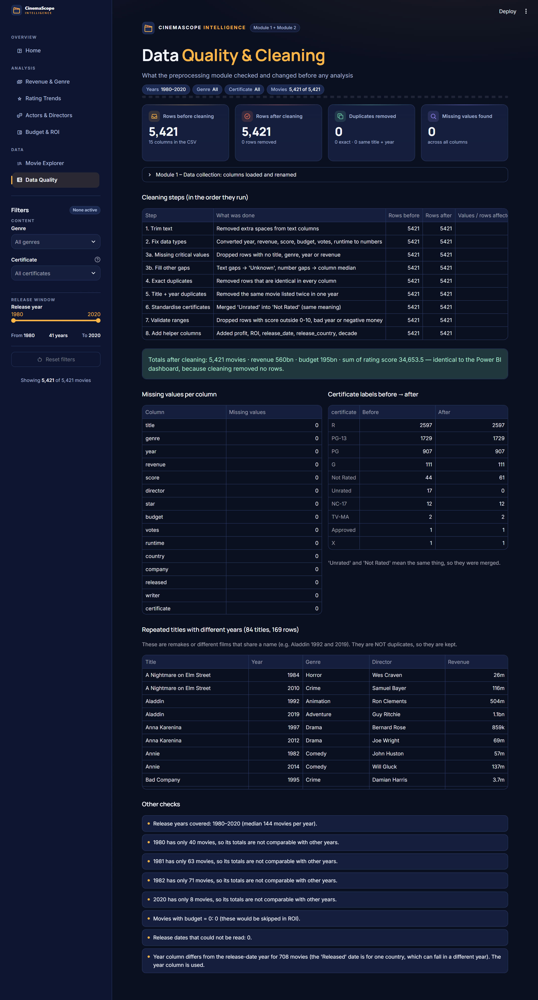

# 🎬 Movie Industry Performance Dashboard

**Professional Training I** · B.E. Computer Science and Engineering
Sathyabama Institute of Science and Technology, Chennai

**Students:** Nihasrika Vijayan (44110534), Nityasri S (44110544) · **Guide:** Dr. M. Selvi

An interactive web dashboard, built with **Python, Pandas, Plotly and Streamlit**, that analyses **5,421 movies (1980–2020)**:
- box-office revenue by genre and year
- rating trends
- top actors and directors
- budget and ROI

It started as a recreation of our Power BI dashboard and now uses its own **CinemaScope Intelligence** look: deep-navy cards, gold and coral charts, KPI cards with per-year sparklines that open the detail pages, and a live "Key insights into market trends" panel. Every chart and insight updates when you change the filters, and the Home page can export the filtered movies as CSV.



---

## ▶️ How to run it (Windows)

**Easiest:** double-click **`run.bat`**.
- The first run creates a virtual environment and installs the requirements (about 2–3 minutes, needs internet).
- The dashboard then opens at <http://localhost:8501>.
- Close the black window to stop it.

**Manually (PowerShell in this folder):**

```powershell
py -3 -m venv .venv
.\.venv\Scripts\python.exe -m pip install -r requirements.txt
.\.venv\Scripts\python.exe -m streamlit run app.py
```

**Other commands** (first install the extra tools: `.\.venv\Scripts\python.exe -m pip install -r requirements-dev.txt`):

```powershell
.\.venv\Scripts\python.exe -m pytest                         # run all 39 tests
.\.venv\Scripts\python.exe scripts\export_figures.py         # charts -> reports\figures\*.png
.\.venv\Scripts\python.exe scripts\make_results_slides.py    # -> results_slides.pptx
# screenshots (app must be running; needs:  pip install playwright)
.\.venv\Scripts\python.exe scripts\take_screenshots.py       # -> reports\screenshots\*.png
.\.venv\Scripts\python.exe scripts\take_screenshots.py http://localhost:8502   # if the app runs on another port
```

Requirements: Windows 10/11, Python 3.10 or newer, and Microsoft Edge or Chrome.

---

## 🧩 The 6 modules → where they are in the code

| Module | What it does | File(s) | Dashboard page |
|---|---|---|---|
| **1. Data Collection** | Loads the CSV and renames the 15 columns to short names (cached) | `src/data_loader.py` | Data Quality (expander) |
| **2. Data Preprocessing** | 8 cleaning steps with a cleaning log: missing values, duplicates, inconsistent labels, invalid values | `src/preprocessing.py` | `pages/6_Data_Quality.py` |
| **3. Revenue & Genre Analysis** | Total, average and median revenue per genre; revenue by year and decade | `src/analysis.py` (Module 3 section) | `pages/1_Revenue_and_Genre.py` |
| **4. Rating Trend Analysis** | Score distribution; score by year, genre and certificate; score vs revenue; votes vs score | `src/analysis.py` (Module 4 section) | `pages/2_Rating_Trends.py` |
| **5. Actor & Director Analysis** | Top stars and directors by revenue and by score; star + director pairs; person look-up | `src/analysis.py` (Module 5 section) | `pages/3_Actors_and_Directors.py` |
| **6. Dashboard & Market Insights** | KPI cards, charts, shared filters, insights generated from the data | `app.py`, `src/figures.py`, `src/charts.py`, `src/filters.py`, `src/insights.py`, `src/ui.py` | Home + all pages |
| *(extra)* Budget & ROI | Budget vs revenue, profit, median ROI by genre | `src/analysis.py` (Budget section) | `pages/4_Budget_and_ROI.py` |
| *(extra)* Movie Explorer | Search, sortable table, download the filtered CSV | — | `pages/5_Movie_Explorer.py` |

## 📁 Folder structure

```
movie-dashboard/
├── app.py                        # Home page + grouped sidebar menu: KPI cards with sparklines, hero revenue chart, insights panel, 5 overview charts, CSV export
├── pages/
│   ├── 1_Revenue_and_Genre.py    # Module 3
│   ├── 2_Rating_Trends.py        # Module 4
│   ├── 3_Actors_and_Directors.py # Module 5
│   ├── 4_Budget_and_ROI.py       # budget vs revenue, profit, median ROI by genre
│   ├── 5_Movie_Explorer.py       # search, sortable table, CSV download
│   └── 6_Data_Quality.py         # Module 2: cleaning log, before/after counts, remakes
├── src/
│   ├── data_loader.py            # Module 1: load + rename columns (cached)
│   ├── preprocessing.py          # Module 2: cleaning steps + cleaning log
│   ├── analysis.py               # Modules 3-5: pure pandas functions (no Streamlit code)
│   ├── figures.py                # every chart, used by the pages AND by export_figures.py
│   ├── charts.py                 # CinemaScope palette + shared Plotly styling, 560bn / 12M / 5.4K format
│   ├── filters.py                # shared sidebar filters (genre, year range, certificate, min movies)
│   ├── insights.py               # Module 6: insight sentences built from real numbers
│   └── ui.py                     # page CSS, brand header + filter chips, KPI cards, insights panel, icons
├── data/cleaned_data_final.csv   # the dataset (5,421 movies x 15 columns)
├── notebooks/eda.ipynb           # exploratory analysis with outputs (for the report)
├── scripts/
│   ├── export_figures.py         # saves every chart as PNG -> reports/figures/
│   ├── make_results_slides.py    # builds results_slides.pptx (python-pptx)
│   └── take_screenshots.py       # full-page screenshots of every page (Playwright + Edge)
├── reports/
│   ├── figures/                  # fig5_1 ... fig5_16 for Chapter 5
│   ├── screenshots/              # one screenshot per dashboard page
│   └── slide_figures/            # larger-font chart copies used in the slides
├── docs/
│   ├── results_chapter.md        # new Chapter 5 with real numbers
│   ├── viva_questions.md         # 25 likely viva questions with short answers
│   └── fixes_for_report_and_ppt.md
├── tests/
│   ├── test_analysis.py          # totals, cleaning, duplicates, top genre/star/director, filters, insights
│   └── test_pages.py             # every page loads; empty and tiny filters do not crash
├── results_slides.pptx           # 6 slides to copy into the PPT
├── .streamlit/config.toml        # dark CinemaScope theme
├── requirements.txt
└── run.bat                       # double-click to install and start
```

## 📊 Main results (all movies)

| | |
|---|---|
| Movies | **5,421** (1980–2020) |
| Total revenue / budget | **560bn / 195bn** USD |
| Sum of rating score | **34,653.5** (average 6.39) |
| Top genre by revenue | **Action** – 238bn, 42% of all revenue |
| Best genre per film (≥ 10 films) | **Animation** – 281M average |
| Top star / director | **Robert Downey Jr.** (11.9bn) / **Steven Spielberg** (9.6bn) |
| Score ↔ revenue / votes ↔ revenue | r = 0.22 (weak) / r = 0.61 (strong) |
| Best median ROI | **Horror** – 208% |

The full discussion is in [docs/results_chapter.md](docs/results_chapter.md).

## 🖼️ Screenshots

| Revenue & Genre | Rating Trends |
|---|---|
|  |  |
| **Actors & Directors** | **Budget & ROI** |
|  |  |
| **Movie Explorer** | **Data Quality** |
|  |  |

## ✅ Design choices worth knowing

- **Insights are never hard-coded.** `src/insights.py` writes every sentence from the filtered data.
- **Small samples are handled honestly.** A *minimum movies per group* slider (default 10) hides tiny groups from average charts, and every tooltip shows the movie count. For example, Family has only 4 films.
- **Medians are used for ROI**, because a few micro-budget hits would distort the average.
- **2020 is flagged as incomplete** (only 8 movies, Jan–Sep). It is drawn dotted in the revenue chart and sparklines, with a note, so its drop is not misread.
- **No crashes on empty filters.** A friendly message is shown instead, and this is checked by the tests.

## Data source

The movie dataset has 15 attributes (title, genre, year, revenue, score, director, star, budget, votes, runtime, country, company, release date, writer, certificate). It matches the Kaggle *Movie Industry* dataset (D. Grijalvo), which was scraped from IMDb. The money values are nominal US dollars and are not adjusted for inflation.
